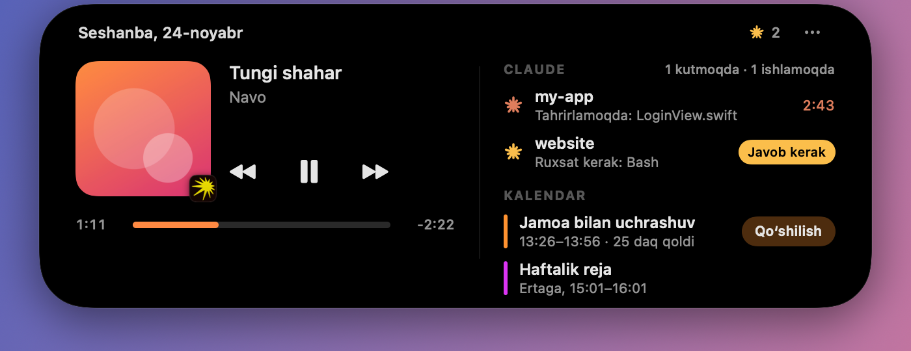
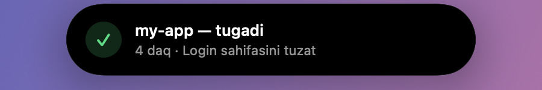

# Orolcha

**Mac uchun Dynamic Island** — musiqa, Claude Code holati va kalendar.
Tashqi monitorda iPhone'dagidek menyu panel o'rtasida suzib turgan kapsula, MacBook'da esa notch'ning o'zidan o'sib chiqadi.

[English below](#english)

<p align="center"></p>

| Musiqa chalinmoqda | Claude ishlamoqda / javob kutmoqda | Qisqa xabar |
|---|---|---|
|  |  |  |

MacBook notch'ida: . Tashqi monitorda ham notch ko'rinishini xohlasangiz: menyu → «Notch koʻrinishi».

## Nimalar bor

- **Musiqa** — har qanday pleyer: Yandex Music, Spotify, Apple Music, brauzer, hatto Telegram ovozli xabarlari. Muqova, to'lqin, boshqaruv tugmalari, progress chizig'ini sudrab o'tkazish. Ranglar muqovadan olinadi.
- **Claude Code** — har bir sessiya: ishlayapti (qaysi faylni tahrirlayotgani, qancha vaqtdan beri), ruxsat kutyapti, tugadi. Tugaganda yoki javob kerak bo'lganda orolcha o'zi ochilib xabar beradi. Qatorni bossangiz, sessiya ochilgan ilova (Claude, Terminal, Warp, VS Code…) oldinga chiqadi.
- **Kalendar** — bugungi va ertangi uchrashuvlar, qancha vaqt qolgani, Google Meet / Zoom / Teams / Telemost havolasi bo'lsa «Qoʻshilish» tugmasi. Uchrashuvdan 5 daqiqa oldin eslatadi.
- **Yengil** — doimiy animatsiyalar Core Animation'da yuradi, bo'sh turganda CPU ~0%.

Hammasi lokal: hech qanday ma'lumot kompyuterdan tashqariga chiqmaydi.

## O'rnatish

Talablar: macOS 14+, Xcode Command Line Tools (`xcode-select --install`). To'liq Xcode shart emas.

```bash
git clone https://github.com/JurakulovUtkir/orolcha.git
cd orolcha
./build.sh install      # yig'adi, ~/Applications/Orolcha.app ga qo'yadi va ishga tushiradi
./install-hooks.sh      # Claude Code hook'larini ulaydi (ixtiyoriy)
```

Birinchi ishga tushganda macOS kalendarga ruxsat so'raydi. Google kalendar ko'rinishi uchun uni **Tizim sozlamalari → Internet Accounts** ga qo'shing.

Kompyuter yoqilganda avtomatik ishga tushishi uchun: orolcha ustiga sichqoncha olib boring → «…» (yoki o'ng tugma) → «Kompyuter yoqilganda ishga tushsin».

## Qanday ishlaydi

| Qism | Fayl | Izoh |
|---|---|---|
| Oyna va shakl | `Sources/IslandController.swift`, `Geometry.swift` | Ramkasiz panel menyu paneldan yuqorida; sichqoncha yaqinlashsagina hodisalarni qabul qiladi, qolgan vaqtda ostidagi oynalarga xalaqit bermaydi |
| Musiqa | `Helper/MediaBridge.m`, `media-bridge.pl` | macOS 15.4 dan beri MediaRemote faqat Apple imzolagan jarayonlarga javob beradi, shuning uchun kutubxona `/usr/bin/perl` ichida yuklanadi |
| Claude | `Sources/ClaudeModel.swift`, `install-hooks.sh` | Hook'lar har hodisani `curl` bilan `127.0.0.1:47811/claude` ga yuboradi. Ilova yopiq bo'lsa, hook jim o'tib ketadi (1 soniya chegarasi) |
| Kalendar | `Sources/CalendarModel.swift` | EventKit |

Hook'larni olib tashlash: `./install-hooks.sh --remove`.

### Tekshiruv

```bash
curl -s 127.0.0.1:47811/state                              # joriy holat (JSON)
build/Orolcha.app/Contents/MacOS/Orolcha --snapshot /tmp/o  # har holatni PNG'ga chizadi
ARCHS=arm64 ./build.sh                                     # faqat Apple Silicon uchun tezroq yig'ish
```

## Cheklovlar

- Musiqa uchun Apple'ning yopiq (private) MediaRemote API'si ishlatiladi. Kelajakdagi macOS yangilanishida ishlamay qolishi mumkin. macOS 27 da sinab ko'rilgan.
- Ilova lokal yig'iladi va ad-hoc imzolanadi. Qayta yig'ilgandan keyin macOS kalendar ruxsatini qayta so'rashi mumkin.
- Interfeys hozircha faqat o'zbek tilida.

## Litsenziya

MIT — [LICENSE](LICENSE).

---

<a id="english"></a>

## English

**Orolcha** ("little island" in Uzbek) is a Dynamic Island for the Mac. On external displays it floats as an iPhone-style pill in the middle of the menu bar; on a MacBook it grows out of the notch itself. It shows:

- **Now playing** from any player (Yandex Music, Spotify, Apple Music, browsers, Telegram voice notes): artwork, an animated waveform tinted from the cover, controls and a scrubbable progress bar.
- **Claude Code sessions** via hooks: working (current tool or file and elapsed time), waiting for permission, finished. The island pops open briefly when a session finishes or needs you. Clicking a row brings its app (Claude, Terminal, Warp, VS Code…) forward.
- **Calendar** (EventKit): today's and tomorrow's events, a countdown and a one-click join button for Meet, Zoom, Teams or Telemost links. It also reminds you 5 minutes before an event.

Everything runs locally and nothing leaves your machine. Persistent animations run on Core Animation, so idle CPU stays around 0%. The UI is currently in Uzbek only.

```bash
git clone https://github.com/JurakulovUtkir/orolcha.git && cd orolcha
./build.sh install      # needs macOS 14+ and Xcode Command Line Tools
./install-hooks.sh      # optional: wire up Claude Code hooks (keeps your existing hooks)
```

Since macOS 15.4, MediaRemote only answers Apple-signed processes, so the now-playing bridge (`Helper/MediaBridge.m`) is loaded inside `/usr/bin/perl`. This relies on a private API and may break in a future macOS release. It has been tested on macOS 27.

License: MIT.
